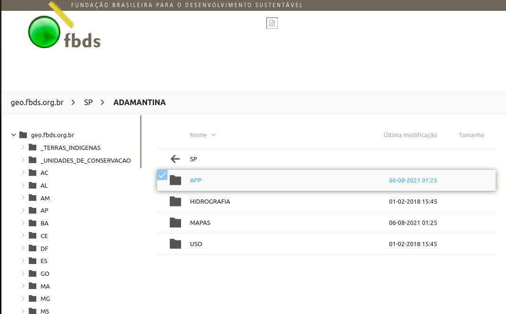
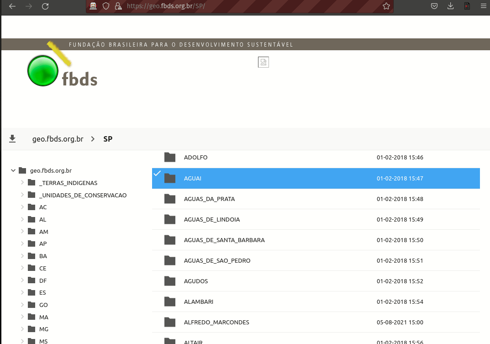

# Abordagens

## _Webscrapping_ (deprecated)

### Primeira Abordagem (_ruim e, portanto, descontinuada_)

A concepção empregada foi obter a lista dos arquivos em formato tabular (_.csv_) para, posteriormente, fazer o _download_.

Usando o [_./scripts_/**01_get_data.ipynb**](scripts/01_get_data.ipynb), foi utilizada a seguinte concepção: Para criar a lista de arquivos, fiz com auxílio do _selenium_. Com o _driver_ eram realizados os seguintes procedimentos:

1. Listar todos as **Subpastas** e **Arquivos** de um diretório raiz;
2. Para cada **Subpasta** encontrada, entra-se nela, e repetir o procedimento de listar **Arquivos**, retornando para a pasta anterior ao final
3. Fazia isso de modo em _loop_, utilizando uma função recursiva.
4. A cada iteração, todas as URLs apresentadas eram colecionadas em um tabela _.csv_.



<br>

Uma vez com todos os links, foi realizado o download usando o JDownloder, com arquivo [_scripts_/**03_download_list_files.ipynb**](scripts/03_download_list_files.ipynb)

<br>

---

### Segunda Abordagem (_melhor!!_)

A partir do [diretório do Estado de São Paulo](https://geo.fbds.org.br/SP/), com 645 pastas (uma para cada município), foi realizado o _download_ da pasta, resultando em 645 arquivos _.tar_. Isso foi feito com o arquivo [_./scripts_/**01_get_data.ipynb**](scripts/01_get_data.ipynb). A ideia era:

1. Listar todos as **Subpastas** (que represetam os municípios) de um diretório raiz;
2. Usando os conceitos de [_ActionChains_](https://www.selenium.dev/selenium/docs/api/py/webdriver/selenium.webdriver.common.action_chains.html), passar o mouse sobre a pasta e clicar nela.
3. Clicar no botão "Fazer Download".



<br>

Após isso, com uso do [_scripts_/**02_adjust_data.ipynb**](scripts/02_adjust_data.ipynb), foram feitos os seguintes procedimentos:

1. Listar todos os arquivos _shapefile (.shp)_ que estão dentro dos arquivos _.tar_, sem descompactar!
2. Criar uma tabela com essa lista de arquivos.
3. Ajustar essa tabela, agregando diversas informações para re-criar os caminhos para o arquivo.
4. Criar cententas de arquivos temporários (com auxílio da bibliotenca [_tempfile_](https://docs.python.org/3/library/tempfile.html)), com o mesmo padrão de nome, evitando a necessidade de descompactar os arquivos _.tar_
5. Listar os arquivos _fake shapefile_ e ajusta-los, para que direcionem ao arquivo dentro do _.tar_
6. Testar e leitura dos arquivos pelo geopandas, conectar e salvar... para cada feição.

<br>

---

## LXML (deprecated)

Esta abordagem consulta as páginas de listagem do portal da FBDS, interpreta o HTML com `lxml` e baixa os arquivos individualmente. Ela foi útil para automatizar a navegação pelas pastas de estados, municípios e _layers_, mas depende da estrutura HTML do _site_ e pode exigir várias requisições para obter os dados de um município.

O fluxo geral é:

1. Consultar a lista de estados e municípios;
2. obter os arquivos disponíveis para um município;
3. selecionar os arquivos desejados e baixá-los em paralelo.

```python
from pyFBDS.lxml import FBDS as FBDSLxml

with FBDSLxml(output_path="./dados") as fbds:
    estados = fbds.get_states()
    municipios = fbds.municipios(uf="SP")

    camada = fbds.get_layer(
        municipality="SANTOS",
        uf="SP",
        layer="APP_USO",
    )
    resultados = fbds.download_files_parallel(
        url_list=[camada],
        max_concurrent=5,
    )
```

`output_path` recebe os arquivos baixados, preservando a estrutura de pastas do portal. O método `get_layer` retorna os dados de um arquivo; `download_files_parallel` recebe uma lista desses dados e faz os downloads.

!!! warning "Abordagem descontinuada"
Para novos usos, prefira a abordagem POST descrita abaixo: ela solicita um arquivo `.tar` do município, em vez de baixar cada arquivo separadamente. O módulo `lxml` ainda é usado internamente para localizar municípios e preparar essa solicitação.

Um exemplo mais detalhado está no [notebook da abordagem LXML](../scripts/lxml/01_lxml.ipynb).

<br>

---

## POST

Esta é a abordagem recomendada atualmente. Em vez de baixar cada _layer_ individualmente, o pacote envia uma requisição HTTP `POST` ao portal da FBDS para obter um arquivo `.tar` com os dados do município. O arquivo é salvo em `output_path`; ao chamar `read_data`, o pacote lê o _shapefile_ solicitado diretamente do arquivo e retorna um `GeoDataFrame`, sem precisar extraí-lo manualmente.

```python
from pyFBDS.post import FBDS

fbds = FBDS(output_path="./dados")
gdf = fbds.read_data(
    municipality="SANTOS",
    uf="SP",
    layer="APP_USO",
)
```

<br>

O método `read_data` baixa o arquivo do município e lê o _layer_ indicado. Os nomes disponíveis podem variar por município. Para consultar os nomes incluídos no arquivo `.tar`, use `download` e `clean_list`:

```python
from pyFBDS.post import FBDS

fbds = FBDS(output_path="./dados")
arquivo = fbds.download(uf="SP", municipality="SANTOS")
layers = fbds.clean_list(arquivo)
print(layers)
```

<br>

Para mais exemplos, incluindo a busca por código do IBGE, consulte os [notebooks da abordagem POST](../scripts/post/01_post.ipynb) e [POST com código do IBGE](../scripts/post/02_post_ibge.ipynb).
